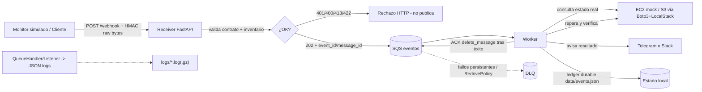

# TP Final 1 - Sistema de Autorreparación de Infraestructura (Proyecto Fénix)

Sistema que recibe una alerta de laboratorio mediante un **webhook autenticado**, la guarda en **SQS**, repara un recurso emulado por **Boto3/LocalStack** y comunica el resultado a **Telegram o Slack**.

> Estado: **sistema completo e integrado**. La suite da **108 passed** con LocalStack y el CI está en verde. La matriz F01–F16 está cerrada y la verificación desde un clon limpio está documentada; solo queda el video.

## 1. Objetivo del sistema

Integrar lo trabajado en Tritón y Vulcano con dos reparaciones pequeñas y verificables:
1. Una instancia **EC2 mock** detenida vuelve a `running`.
2. Un bucket **S3** recupera las **etiquetas obligatorias**.

Flujo: `POST /webhook` (HMAC, raw bytes) → validación + publicación en SQS (202) → worker consume → repara y verifica por API → notifica → confirma (ACK/delete) solo tras éxito durable. Mensajes fallidos se reintentan y van a **DLQ** si persiste la falla. Repetir el mismo evento o reiniciar el worker **no repite acciones ya verificadas** (idempotencia por `event_id` + ledger).

## 2. Integrantes y roles

| Rol | Apellido y nombre | Correo | Módulos principales | Pruebas defendidas |
|---|---|---|---|---|
| I1 - Entradas y Excepciones | Herrera, Nancy Mariel | nancy506herre@gmail.com | `src/fenix/utils/validation.py`, `src/fenix/utils/errors.py`, `src/fenix/services/events.py` | tests/test_i1_entradas.py (21 tests de validación y rechazo de entradas) |
| I2 - Mensajería e Inventario Cloud | Maldonado, Fernando Manuel | bynanofer@gmail.com | `src/fenix/services/sqs.py`, `src/fenix/services/demo.py` | `tests/test_i2_mensajeria.py` (11: 9 unitarios + 2 de integración) + `tests/test_scenarios.py::test_redrive_with_localstack` (custodia I6) |
| I3 - Webhooks y Reparación | Mamani, Hector Mauricio | maurobvx@gmail.com | `src/fenix/utils/crypto.py`, `src/fenix/services/receiver.py`, `src/fenix/services/remediation.py` (`repair`) | `tests/test_i3_webhooks.py` (11 casos) |
| I4 - Observabilidad y Comunicación | Alegre, Facundo Sebastián | facundosebasalegre@gmail.com | `src/fenix/utils/logging_json.py`, `src/fenix/services/notifications.py` | `tests/test_i4_observabilidad.py` (29 casos) |
| I5 - Integración y Worker | Rodríguez, Hector Fernando | elferchurodriguez08@gmail.com | `src/fenix/services/worker.py`, `src/fenix/services/remediation.py` (`handle`), `src/fenix/cli.py` | `tests/test_i5_worker.py` (13 casos) |
| I6 - Pruebas y Diagnóstico | Gaspar, Lautaro Miguel Angel | lautaro.lg48@gmail.com | `tests/`, `src/fenix/services/demo.py` (`inject_fault`) | `tests/test_i6_diagnostico.py` (10 casos) + `tests/test_scenarios.py` (5: 3 unitarios + 2 de integración) |

> **Nota**: el correo es obligatorio en la entrega. Cada estudiante debe poder explicar y modificar su código, realizar commits propios y revisar al menos un módulo de otro compañero. La asignación operativa está en [`docs/ROLES.md`](docs/ROLES.md).

## 3. Prerrequisitos y versiones

- Python **3.14.4** (misma versión para todo el grupo; mínimo admitido 3.11). La evidencia F15 se tomó con 3.14.5 en Windows; no cambia dependencias ni resultados.
- Docker Engine 29+ y Docker Compose 2.40+
- LocalStack **3.8.0** (imagen Community del Lab-1, **sin token**) con `sqs,s3,ec2` y `EC2_VM_MANAGER=mock`
- Dependencias: `boto3`, `fastapi`, `uvicorn`, `requests`, `python-dotenv`, `pytest`, `httpx` (versiones exactas en `requirements-lock.txt`)
- Guía de instalación y problemas frecuentes: [`docs/ENTORNO.md`](docs/ENTORNO.md)

## 4. Instalación desde cero

```bash
# 1) Crear y activar entorno virtual
python3 -m venv .venv
source .venv/bin/activate   # Windows PowerShell: .venv\Scripts\Activate.ps1

# 2) Instalar el paquete en modo editable
python -m pip install --upgrade pip
python -m pip install -e .

# 3) Configurar variables de entorno (sin valores privados)
cp .env.example .env
# Generar WEBHOOK_SECRET:
python -c "import secrets; print(secrets.token_urlsafe(32))"
# Pegar en .env -> WEBHOOK_SECRET=...

# 4) Verificar el entorno antes de levantar nada
python scripts/doctor.py

# 5) Levantar LocalStack y esperar el healthcheck
docker compose up -d

# 6) Smoke real con Boto3 (crea y limpia recursos efímeros)
python scripts/check_localstack.py
```

- `scripts/doctor.py` comprueba Python, `.env`, variables obligatorias, destino loopback, imagen, Docker/Compose y salud del emulador. **No imprime secretos.**
- `scripts/check_localstack.py` valida SQS + DLQ, S3 con tags y EC2 mock (`stop`/`start`) contra LocalStack real.
- La verificación desde un clon limpio está en [`evidence/clon-limpio.md`](evidence/clon-limpio.md): instalación, `doctor.py` y suite completa.
- Las versiones efectivas están fijadas en `requirements-lock.txt` (generado con `pip freeze --exclude-editable`). No editarlo a mano.
- Para reinstalar exactamente lo probado: `python -m pip install -r requirements-lock.txt`.

## 5. Variables de entorno (sin valores privados)

Ver `.env.example` (plantilla canónica). Completar en `.env` local (nunca commitear):

| Variable | Obligatoria | Valor / nota |
|---|---:|---|
| `AWS_ENDPOINT_URL` | sí | `http://localhost:4566` (solo loopback, sin credenciales en la URL) |
| `AWS_ACCESS_KEY_ID` / `AWS_SECRET_ACCESS_KEY` | sí | `test` / `test` (credenciales ficticias del emulador) |
| `AWS_DEFAULT_REGION` | sí | `us-east-1` (no usar `AWS_REGION`) |
| `GROUP_ID` / `QUEUE_PREFIX` | sí | Patrón `[a-z0-9-]{3,32}` |
| `PROJECT` | no | `fenix` (etiqueta de recursos; documental) |
| `WEBHOOK_SECRET` | sí | Generado con `secrets.token_urlsafe(32)`; mínimo 16 caracteres |
| `NOTIFY_PROVIDER` | sí | `console` (por defecto) · `telegram` · `slack` |
| `TELEGRAM_BOT_TOKEN` / `TELEGRAM_CHAT_ID` | si `telegram` | Credenciales del bot |
| `SLACK_WEBHOOK_URL` | si `slack` | Incoming Webhook |
| `LOCALSTACK_IMAGE` | sí | `localstack/localstack:3.8.0` (sin token) |
| `LOCALSTACK_AUTH_TOKEN` | no | Solo si se adopta una imagen 2026+ |

> **Canal elegido: Telegram** (crear bot con @BotFather, obtener `chat_id`, llamar `sendMessage`). Slack queda como alternativa descartada; la decisión está en [`docs/DECISIONES.md`](docs/DECISIONES.md). El default local sigue siendo `console` para no exigir credenciales.
>
> **Trampa frecuente:** `python-dotenv` **no sobrescribe** variables ya exportadas en la terminal. Si un cambio en `.env` “no toma”, revisar `env | grep AWS_` o abrir una terminal nueva.

## 6. Arquitectura (Mermaid)



> **Hito 4 (flujo completo):** el diagrama refleja el sistema ya integrado en `main`. Las funciones de negocio de los seis roles están implementadas y no queda ningún `NotImplementedError` en el código.

## 7. Contratos de entrada/salida

### Evento (JSON cerrado)
```json
{
  "schema_version": 1,
  "event_id": "evt-node-001",
  "event_type": "instance.stopped",
  "resource_id": "node-01",
  "occurred_at": "2026-10-22T18:00:00Z",
  "simulate_failures": 0
}
```
- `event_id` / `resource_id`: `[a-z0-9-]{3,32}`.
- `event_type`: `instance.stopped` | `bucket.tags_missing` (compatible con inventario).
- `simulate_failures`: entero 0-5 (nunca `bool`). Cuenta persistida en disco.
- Webhook acepta **aliases** conocidos (`node-01`, `bucket-01`), no IDs arbitrarios.

### Firma HMAC
`HMAC-SHA256(secret, bytes(t) + b"." + raw_body)`  
Cabecera: `X-Webhook-Signature: t=<epoch>,v1=<64 hex>` (ventana 300s).

### Orden del receptor y correlación

1. Rechaza el cuerpo que excede 16 KiB con **413**; aplica el conteo también a
   transferencias sin `Content-Length` confiable.
2. Exige una sola cabecera `X-Webhook-Signature`, verifica `t`/`v1` estrictos y
   el HMAC sobre los bytes originales. Cualquier fallo de autenticación es
   **401**, sin exponer si falló formato, tiempo o digest.
3. Solo con firma válida decodifica UTF-8 y JSON estricto (**400**) y después
   valida el contrato cerrado y el alias del inventario (**422**).
4. Resuelve la cola y ejecuta el `send_message` síncrono de Boto3 mediante un
   hilo de trabajo, esperando su `MessageId`. Un error de SQS/configuración es
   **503**: nunca se responde aceptación sin persistencia confirmada.
5. Recién entonces devuelve **202** con `event_id` y `message_id`. El primero
   también viaja como atributo SQS `EventId` y es la correlación con worker,
   ledger y logs. El receptor no repara ni notifica.

El límite tiene precedencia sobre la firma para limitar consumo de recursos;
para los cuerpos dentro del límite la autenticación precede todo parseo JSON.

### Respuestas HTTP del receptor
| Situación | HTTP | Efecto |
|---|---:|---|
| Firma ausente/malformada/incorrecta/fuera de ventana | 401 | No publicar |
| Cuerpo > 16 KiB | 413 | No publicar |
| JSON roto o UTF-8 inválido (firma válida) | 400 | No publicar |
| JSON válido pero contrato incorrecto | 422 | No publicar |
| SQS no disponible tras validar | 503 | No prometer aceptación |
| `send_message` confirmado por SQS | 202 | Devuelve `event_id`/`message_id`; worker procesa después |

## 8. Ejecución por terminal

```bash
# Preparar colas e inventario (idempotente)
python -m fenix.cli init-queues
python -m fenix.cli setup-demo
python -m fenix.cli fault node-01

# Terminal 1: receptor (1 worker)
python -m uvicorn fenix.services.receiver:app --host 127.0.0.1 --port 8000 --workers 1 --env-file .env

# Terminal 2: worker
python -m fenix.cli worker

# Terminal 3: enviar alerta firmada
python -m fenix.cli send examples/node-event.json
```

> Actualizar `occurred_at` en ejemplos para evidencias claras; la CLI genera timestamp HMAC nuevo al enviar.

## 9. Reglas de reintento y DLQ

- Cola estándar SQS + **DLQ** con `RedrivePolicy` (`maxReceiveCount=3`).
- `VisibilityTimeout=45`, long polling 10s.
- Backoff por recepción: `min(30, 2 ** numero_de_recepcion)` (2, 4, 8...).
- **No** reenviar con `send_message` nuevo al reintentar; **no** borrar mensajes venenosos para ocultarlos.
- ACK (`delete_message` con `ReceiptHandle` actual) **solo después** de reparar y notificar con éxito durable.

## 10. Decisiones de idempotencia

- `event_id` identifica la operación de negocio. Ledger en `data/events.json` registra `attempts`, `repair_done`, `repair_result`, `notified`, `status`.
- Repetir el mismo evento (o reiniciar worker) no repite acciones ya verificadas: se consultan estados reales y se retoman pasos pendientes (ej. reenviar aviso sin re-reparar).
- Mismo `event_id` con contenido distinto → conflicto registrado; conservar para DLQ; no alterar primer registro.

## 11. Matriz de pruebas (F01–F16)

| ID | Caso | Preparación | Resultado esperado | Resultado obtenido | Evidencia | Responsable | Fecha |
|---|---|---|---|---|---|---|---|
| F01 | init-queues/setup-demo x2 | `init-queues` x2 + `setup-demo` x2 | Mismas colas/recursos; sin duplicados | Mismas URLs de cola; mismo `InstanceId`, SG y bucket; 0 duplicados | [`evidence/F01-init-queues-idempotente.md`](evidence/F01-init-queues-idempotente.md) | I2 | 2026-11-13 |
| F02 | Nodo detenido → alerta válida | `init-queues` + `setup-demo` + `fault node-01`; evento nuevo firmado: `cli send` + `worker --once` | Running verificado, ledger completo, aviso y ACK | Estado inicial `stopped`; `cli send` → 202 con `event_id`/`message_id`; el worker reparó (`repaired`) y confirmó (`acknowledged`); por SDK la instancia `i-9a6ddddbc0603ac1f` quedó `running`; ledger `attempts=1`, `repair_done`, `notified`, `status=done`; cola en 0; prueba automática `1 passed` | [`evidence/F02-nodo-detenido-reparado.md`](evidence/F02-nodo-detenido-reparado.md) · `tests/test_i3_webhooks.py::test_repair_starts_stopped_instance_and_rechecks_running` | I3 | 2026-11-16 |
| F03 | Bucket sin tag Owner | `init-queues` + `setup-demo`; tag ajena `Ambiente` + `fault bucket-01`; evento nuevo firmado: `cli send` + `worker --once` | Tags restauradas; ajenas preservadas | Tags iniciales sin `Owner` y con `Ambiente=laboratorio`; `cli send` → 202; el worker reparó y confirmó; tags finales: las cuatro obligatorias más `Ambiente=laboratorio` intacta; ledger completo (`attempts=1`, `status=done`); cola en 0; prueba automática `1 passed` | [`evidence/F03-bucket-tags-restauradas.md`](evidence/F03-bucket-tags-restauradas.md) · `tests/test_i3_webhooks.py::test_repair_merges_tags_and_verifies_s3_result` | I3 | 2026-11-16 |
| F04 | Firma ausente/alterada/timestamp viejo | Receptor en `:8000`; mismo cuerpo con firma ausente, un hex alterado y `t` de −3600 s; `pytest tests/test_i3_webhooks.py -k "invalid_signature or strict_t_and_v1 or only_after_authentication" -v` | 401; ningún mensaje nuevo | Los 3 envíos respondieron `401 {"detail":"Firma de webhook inválida"}` (mismo detalle genérico); la cola quedó en 0/0/0 antes y después; el log de Uvicorn registra 3 × `401 Unauthorized`; pruebas automáticas `5 passed, 6 deselected` | [`evidence/F04-firma-invalida-401.md`](evidence/F04-firma-invalida-401.md) | I3 | 2026-11-17 |
| F05 | Mismos datos, bytes distintos tras firmar | Receptor en `:8000`; se firma `{"x":1}` y se envía `{"x": 1}` con esa firma | 401 por HMAC inválida | `401 {"detail":"Firma de webhook inválida"}`; cola en 0 antes y después; sin `MessageId` porque no hubo publicación | [`evidence/F05-bytes-distintos-401.md`](evidence/F05-bytes-distintos-401.md) | I3 | 2026-11-17 |
| F06 | JSON roto firmado; lista JSON firmada | Receptor en `:8000`; cuerpo incompleto y lista JSON con firma válida | 400 y 422; sin publicación | `400 {"detail":"JSON inválido"}` para el JSON roto y `422 {"detail":"Evento no válido"}` para la lista; cola en 0 antes y después | [`evidence/F06-json-invalido-400-422.md`](evidence/F06-json-invalido-400-422.md) | I3 | 2026-11-17 |
| F07 | Alias ajeno y claves extra | Receptor en `:8000`; evento firmado con `resource_id=node-99` y variante con clave `extra` | Rechazo; ningún cambio cloud | Ambos envíos respondieron `422 {"detail":"Evento no válido"}`; cola en 0; no hubo cambios en EC2/S3 porque no se publicó ningún mensaje | [`evidence/F07-alias-claves-422.md`](evidence/F07-alias-claves-422.md) | I3 | 2026-11-17 |
| F08 | JSON corrupto inyectado directo a SQS | `pytest tests/test_scenarios.py::test_redrive_with_localstack -v` con LocalStack | Worker sigue; mensaje termina en DLQ | `1 passed`; el `Body` corrupto `{esto no es json` se leyó desde la DLQ y el worker siguió vivo con la cola vacía | [`evidence/F08-json-corrupto-dlq.md`](evidence/F08-json-corrupto-dlq.md) | I6 | 2026-11-14 |
| F09 | `simulate_failures=2` (ID nuevo) | `init-queues` + `setup-demo` + nodo detenido; evento con `event_id` nuevo a SQS | Backoff; luego reparación y ACK | 3 intentos: 1 y 2 `RetryableError` (visibilidad 2 s y 4 s); intento 3 `repair_done`/`notified`/`status=done` con `acknowledged`; nodo `running` por SDK; cola en 0 | [`evidence/F09-backoff-reintentos.md`](evidence/F09-backoff-reintentos.md) | I2 | 2026-11-15 |
| F10 | Falla persistente (ID nuevo) | Colas propias `fenix-i2dlq-20261114` + `simulate_failures=5` | Sin ACK; derivación a DLQ | 3 intentos sin ACK; redrive a la DLQ; mensaje leído con `Body` original, `ApproximateReceiveCount=4` y `DeadLetterQueueSourceArn`; cola de trabajo en 0 | [`F10-lectura-dlq.md`](evidence/F10-lectura-dlq.md) · [`F10-falla-persistente-dlq.md`](evidence/F10-falla-persistente-dlq.md) | I2 | 2026-11-14 |
| F11 | Repetir evento completo; reiniciar worker | `pytest tests/test_scenarios.py::test_duplicate_is_idempotent tests/test_scenarios.py::test_ack_is_after_success -v` | Sin nueva reparación ni aviso confirmado | `2 passed`; el segundo procesamiento no repara ni avisa; el ACK ocurre solo después del éxito | [`evidence/F11-duplicado-idempotente.md`](evidence/F11-duplicado-idempotente.md) | I6 | 2026-11-14 |
| F12 | Cortar tras `repair_done` antes de `notify` | `pytest tests/test_scenarios.py::test_restart_after_repair_only_notifies -v` | Reinicio recupera solo aviso pendiente | `1 passed`; con `repair_done` ya registrado, el reinicio solo envía el aviso y no repite la reparación | [`evidence/F12-reinicio-solo-aviso.md`](evidence/F12-reinicio-solo-aviso.md) | I6 | 2026-11-14 |
| F13 | SQS detenido al recibir webhook | Receptor en `:8000`; `docker compose stop localstack`; evento válido firmado | 503; no aceptación falsa | `503 {"detail":"Cola no disponible"}` y ningún 202; después se reinició LocalStack | [`evidence/F13-sqs-caido-503.md`](evidence/F13-sqs-caido-503.md) | I2 | 2026-11-17 |
| F14 | Mock aviso 429/timeout luego éxito | `notify` con 429 y `handle` de nuevo | No repite reparación; reintenta aviso | `3 passed`; 429 y timeout → `RetryableError`, reparación 1 vez y aviso confirmado en el reintento; incluye el envío real por Telegram | [`evidence/F14-429-timeout.md`](evidence/F14-429-timeout.md) | I4 | 2026-11-17 |
| F15 | Cambiar payload conservando `event_id` | `handle` dos veces con distinto contenido | Conflicto; no altera ledger/recursos originales | Conflicto en `_conflicts`; registro original y recursos intactos; sin ACK | [`evidence/F15-conflicto-event-id.md`](evidence/F15-conflicto-event-id.md) · `tests/test_i5_worker.py::test_handle_registra_conflicto_sin_cambiar_el_original` | I5 | 2026-11-13 |
| F16 | Forzar rotación, leer `.gz`, parsear líneas | `RotatingFileHandler` reducido con `gzip_rotate` | JSON válido, UTC, contexto; sin secretos | `1 passed`; `.jsonl.1.gz` adjunto (4 líneas) con timestamp UTC y solo campos autorizados | [`evidence/F16-rotacion-gzip.md`](evidence/F16-rotacion-gzip.md) | I4 | 2026-11-17 |

> Automáticas sugeridas: F04,F05,F06,F07,F09,F11/F12,F16. Integración LocalStack: F01,F02,F03,F08,F10,F13.
>
> **Cobertura de la matriz:** F01–F16 tienen archivo en [`evidence/`](evidence/README.md) con comando y salida real. F01 incluye además la recuperación de un bucket creado sin etiquetas. Los tests unitarios corren sin red; las corridas reales de F01–F13 requieren LocalStack y, para F04–F07 y F13, el receptor en `:8000`.
>
> **Observabilidad (O1/O2):** los logs JSON de un evento nominal y de un mensaje corrupto están en [`evidence/O1-logs.md`](evidence/O1-logs.md) (con los `.jsonl` adjuntos), y los cinco niveles en [`evidence/O2-niveles-log.md`](evidence/O2-niveles-log.md). El worker registra cada paso con `event_id`, `attempt` y `status`.
>
> **Cómo completar la matriz:** cada fila se cierra con un archivo en [`evidence/`](evidence/README.md) (fecha, comando, salida real sin secretos) y, si corresponde, una captura en `docs/images/`. **I6** custodia la matriz completa y valida la asignación de casos F; cada rol aporta la evidencia de sus funciones. No se completa con “funcionó”: hace falta comando + resultado.

## 12. Limitaciones

1. **EC2 mock no es una VM real:** `EC2_VM_MANAGER=mock` no reproduce latencias ni fallos de hardware. Los reintentos y el backoff se demuestran con `simulate_failures` y la DLQ.
2. **VPC default:** se usa la VPC predeterminada del emulador por simplicidad de laboratorio; en producción se usaría una VPC propia con subredes y SG acotados.
3. **Un solo writer sobre `data/`:** `data/events.json` no tiene bloqueo entre procesos. No correr dos workers sobre el mismo proyecto.
4. **Estado efímero:** LocalStack no usa volumen persistente; `docker compose down` borra colas, buckets e instancias. Hay que repetir `init-queues` y `setup-demo`.
5. **Aviso potencialmente duplicado:** si el worker muere después de enviar la notificación y antes de persistir `notified`, el reinicio puede reenviarla. No se promete *exactly-once*.
6. **Ventana HMAC:** los 300 s rechazan entregas viejas, pero **no** impiden repetir un evento válido dentro de la ventana; para eso está `event_id` + ledger.
7. **`python-dotenv` no sobrescribe** variables ya exportadas en la terminal.
8. **Notificación sujeta a terceros:** la disponibilidad de Telegram/Slack no depende del equipo; 429 y 5xx se reintentan con tope de `Retry-After` de 30 s.
9. **Logs sin `exc_info`:** `JSONFormatter` de apoyo no serializa trazas; si se necesitan, I4 debe acordar el cambio (ver [`docs/DECISIONES.md`](docs/DECISIONES.md)).

## 13. Evidencia del canal elegido (Telegram)

**Canal elegido: Telegram** (`NOTIFY_PROVIDER=telegram`). El default local sigue siendo `console` para trabajar sin credenciales.

**Evidencia de envío real (I4 - Alegre, Facundo Sebastián):**

- Estado: **Enviado** el 2026-11-16.
- El código de `notify` está implementado y probado con mocks (29 tests passed en `tests/test_i4_observabilidad.py`).
- Captura anonimizada: [`docs/images/evidencia-telegram-i4.png`](docs/images/evidencia-telegram-i4.png); recortada para excluir chats de terceros y con el token de la URL y el identificador del chat tapados.
- Comando usado (carga `.env` explícitamente porque `notifications.py` no lo hace solo):
  ```bash
  set -a
  source .env
  set +a
  NOTIFY_PROVIDER=telegram python -c "from fenix.services.notifications import notify; notify('Prueba Fénix I4 - Facundo Alegre')"
  ```
  `TELEGRAM_BOT_TOKEN` y `TELEGRAM_CHAT_ID` deben estar completos en `.env`.
  Para Slack, cambiar `NOTIFY_PROVIDER` a `slack` y completar `SLACK_WEBHOOK_URL`.

## 14. Limpieza del laboratorio

Después de documentar la evidencia (sobre todo la DLQ) se ejecutó esta limpieza
con el SDK contra el inventario. Cada bloque informa qué eliminó; si un recurso
ya no existe, se saltea ese bloque para no abortar el resto.

```bash
python - <<'PY'
import json, time
from dotenv import load_dotenv
load_dotenv(".env")
from fenix.config.settings import client
from fenix.services import sqs

inv = json.load(open("data/inventory.json", encoding="utf-8"))
iid = inv["node-01"]["id"]
bucket = inv["bucket-01"]["id"]
sg = inv["node-01"]["security_group_id"]
ec2, s3, sqsc = client("ec2"), client("s3"), sqs.client("sqs")

# 1) Colas propias del ensayo de DLQ (solo después de documentar el mensaje).
for name in ("fenix-i2dlq-20261114-events", "fenix-i2dlq-20261114-dlq"):
    sqsc.delete_queue(QueueUrl=sqsc.get_queue_url(QueueName=name)["QueueUrl"])
    print("cola eliminada:", name)

# 2) Instancia inventariada: terminar y esperar el estado final.
ec2.terminate_instances(InstanceIds=[iid])
for _ in range(30):
    r = ec2.describe_instances(InstanceIds=[iid])["Reservations"]
    state = [i["State"]["Name"] for x in r for i in x["Instances"]][0]
    if state == "terminated":
        break
    time.sleep(1)
print("instancia:", iid, state)

# 3) Bucket: vaciar objetos si quedaron y borrar.
objs = s3.list_objects_v2(Bucket=bucket).get("Contents", [])
if objs:
    s3.delete_objects(Bucket=bucket,
                      Delete={"Objects": [{"Key": o["Key"]} for o in objs]})
s3.delete_bucket(Bucket=bucket)
print("bucket eliminado:", bucket)

# 4) Security group: reintentar hasta que EC2 libere la instancia.
for _ in range(15):
    try:
        ec2.delete_security_group(GroupId=sg)
        print("SG eliminado:", sg)
        break
    except Exception as error:
        last = error
        time.sleep(1)
else:
    print("SG:", type(last).__name__, last)

# 5) Colas del grupo, si el laboratorio estaba en uso.
for name in ("fenix-grupo01-events", "fenix-grupo01-dlq"):
    try:
        sqsc.delete_queue(QueueUrl=sqsc.get_queue_url(QueueName=name)["QueueUrl"])
        print("cola eliminada:", name)
    except Exception as error:
        print("cola", name, ":", type(error).__name__)
PY
docker compose down
```

Salida real de la última limpieza (2026-11-14):

```text
cola eliminada: fenix-i2dlq-20261114-events
cola eliminada: fenix-i2dlq-20261114-dlq
instancia: i-99bda695003fb5be9 terminated
bucket eliminado: fenix-grupo01-demo
SG eliminado: sg-d7daa57e468b09d4a
cola eliminada: fenix-grupo01-events
cola eliminada: fenix-grupo01-dlq
 Container fenix-localstack  Removed
 Network fenix_default  Removed
```

Orden importante:

1. Documentar la DLQ **antes** de borrar las colas; si no, se pierde la prueba.
2. Terminar la instancia antes de borrar el security group (EC2 lo retiene
   mientras haya ENIs asociadas).
3. Vaciar el bucket antes de borrarlo.
4. `docker compose down` al final: sin volumen persistente, el próximo
   `up -d` arranca el emulador limpio y `setup-demo` reconcilia el inventario.

## 15. Video y marcas de tiempo

| Integrante | Marca de tiempo | Contenido |
|---|---|---|
| Herrera Nancy Mariel (I1) | 00:00 | _Completar_ |
| Maldonado, Fernando Manuel (I2) | 00:00 | _Completar_ |
| Mamani, Hector Mauricio (I3) | 00:00 | _Completar_ |
| Alegre, Facundo Sebastián (I4) | 00:00 | _Completar_ |
| Rodríguez, Hector Fernando (I5) | 00:00 | _Completar_ |
| Gaspar Lautaro Miguel Angel (I6) | 00:00 | _Completar_ |

Link al video: _Completar_

## 16. Declaración de ayuda externa e IA

Para el desarrollo se utilizaron asistentes de IA como apoyo para consultas, revisión de código, redacción de pruebas y documentación. Solo I2 utilizó un **Asistente de IA local** (Qwen/Gemma); el resto trabajó con asistentes en la nube. En todos los casos, el código fue leído, adaptado y ejecutado por el integrante responsable de cada módulo. Las pruebas y las salidas de las evidencias se obtuvieron con comandos reales sobre LocalStack y se revisaron manualmente; no se incorporaron resultados sin verificarlos.

| Integrante | Herramientas | Uso principal | Módulos / pruebas | Verificación |
|---|---|---|---|---|
| Herrera, Nancy Mariel (I1) | Gemini | Consulta y revisión de reglas de validación; redacción de casos de prueba. | `validation.py`, `events.py`, `test_i1_entradas.py` | `pytest tests/test_i1_entradas.py -q` y revisión manual de rechazos. |
| Maldonado, Fernando Manuel (I2) | Agente de IA local Qwen, Gemma | Apoyo en la revisión de idempotencia de colas, inventario y backoff. | `sqs.py`, `demo.py`, `test_i2_mensajeria.py` | `pytest tests/test_i2_mensajeria.py -q` con LocalStack; comparación manual de IDs y atributos. |
| Mamani, Hector Mauricio (I3) | Gemini, ChatGPT | Apoyo en la revisión de HMAC, receptor y clasificación de errores. | `crypto.py`, `receiver.py`, `remediation.py`, `test_i3_webhooks.py` | `pytest tests/test_i3_webhooks.py -q`; pruebas con firmas alteradas y receptor real. |
| Alegre, Facundo Sebastián (I4) | DeepSeek | Apoyo en la revisión del formato JSON, rotación de logs y reintentos de aviso. | `logging_json.py`, `notifications.py`, `test_i4_observabilidad.py` | `pytest tests/test_i4_observabilidad.py -q`; revisión de logs reales y prueba de 429. |
| Rodríguez, Hector Fernando (I5) | DeepSeek, GitHub Copilot de VS Code | Apoyo en la revisión del worker, ledger, ACK y reanudación. | `worker.py`, `remediation.py` (`handle`), `cli.py`, `test_i5_worker.py` | `pytest tests/test_i5_worker.py -q`; ejecución manual de `worker --once` y `simulate_failures`. |
| Gaspar, Lautaro Miguel Angel (I6) | Claude Code, Gemini | Apoyo en la revisión de escenarios, diagnóstico y DLQ. | `tests/`, `demo.py` (`inject_fault`), `test_i6_diagnostico.py`, `test_scenarios.py` | `pytest tests/test_i6_diagnostico.py tests/test_scenarios.py -q`; inyección manual de JSON corrupto y lectura de DLQ. |

Cada integrante revisó su módulo y cuenta con la documentación y las pruebas del repositorio para explicar las decisiones y realizar los cambios solicitados durante la defensa. Las herramientas se utilizaron como apoyo; la implementación final y la ejecución de las pruebas fueron responsabilidad de cada integrante.

## 17. Estructura del repositorio

```text
fenix/
├── compose.yaml                  # LocalStack 3.8.0 + healthcheck + EC2 mock
├── pyproject.toml                # Paquete, dependencias y marcadores de pytest
├── requirements.txt              # Dependencias declaradas
├── requirements-lock.txt         # Versiones efectivas (pip freeze)
├── .env.example                  # Plantilla de variables (sin secretos)
├── .python-version               # 3.14
├── README.md                     # Entrega formal
├── CONTRIBUTING.md               # Ramas, commits, PR y reglas de código
├── architecture.png              # Diagrama de arquitectura
├── docs/
│   ├── ROLES.md                  # Qué hace cada rol, archivos, pruebas y DoD
│   ├── ENTORNO.md                # Instalación, LocalStack y problemas frecuentes
│   ├── DECISIONES.md             # Decisiones de diseño y limitaciones
│   ├── GUIA_DEFENSA.md           # Guion del video y modificaciones en vivo
│   └── images/                   # Capturas anonimizadas referenciadas por las evidencias
├── evidence/                     # Evidencia reproducible F01–F16
├── examples/                     # Eventos de ejemplo firmables
├── scripts/
│   ├── doctor.py                 # Diagnóstico del entorno (sin secretos)
│   └── check_localstack.py       # Smoke real SQS/S3/EC2 con limpieza
├── src/fenix/
│   ├── cli.py                    # init-queues, setup-demo, fault, worker, send
│   ├── config/settings.py        # Guardián loopback + timeouts (congelado)
│   ├── services/
│   │   ├── events.py             # I1: contrato del evento
│   │   ├── sqs.py                # I2: colas, publish, receive, ACK, backoff
│   │   ├── demo.py               # I2: setup_demo · I6: inject_fault
│   │   ├── receiver.py           # I3: POST /webhook
│   │   ├── remediation.py        # I3: repair · I5: handle
│   │   ├── notifications.py      # I4: notify
│   │   ├── worker.py             # I5: run
│   │   └── cloud_support.py      # Recetas Boto3 (apoyo)
│   └── utils/
│       ├── validation.py         # I1: identifier, ttl_seconds, utc_text
│       ├── crypto.py             # I3: verify HMAC
│       ├── state.py              # Ledger atómico (apoyo)
│       ├── errors.py             # Jerarquía de errores (apoyo)
│       └── logging_json.py       # Logs JSON con rotación (apoyo)
├── tests/
│   ├── test_base.py              # Apoyo del template (marca base)
│   ├── test_contracts.py         # Contratos I1 (sin marca)
│   ├── test_fenix.py             # HMAC sobre bytes crudos
│   ├── test_i1_entradas.py       # I1: validación de entradas
│   ├── test_i2_mensajeria.py     # I2: colas, inventario y backoff
│   ├── test_i3_webhooks.py       # I3: receptor y reparación
│   ├── test_i4_observabilidad.py # I4: avisos y logs JSON
│   ├── test_i5_worker.py         # I5: worker, ACK y ledger
│   ├── test_i6_diagnostico.py    # I6: inject_fault con fakes
│   └── test_scenarios.py         # Escenarios F08/F10/F11/F12
└── .github/
    ├── workflows/ci.yml          # Tests base + integración con LocalStack + compose + doctor
    └── pull_request_template.md  # Checklist de PR
```

## 18. Estado por rol

Todos los roles están integrados en `main` y no queda ningún
`NotImplementedError` en la lógica de negocio.

| Rol | Integrante | Módulos entregados | Estado |
|---|---|---|---|
| I1 | Herrera, Nancy Mariel | `utils/validation.py`, `utils/errors.py`, `services/events.py` | Integrado (#7) |
| I2 | Maldonado, Fernando Manuel | `services/sqs.py`, `services/demo.py` (`setup_demo`) | Integrado (#1, #9) + evidencia F01/F09/F10/F13 (#14) |
| I3 | Mamani, Hector Mauricio | `utils/crypto.py`, `services/receiver.py`, `services/remediation.py` (`repair`) | Integrado (#12) + evidencia F02–F07 |
| I4 | Alegre, Facundo Sebastián | `utils/logging_json.py`, `services/notifications.py` | Integrado (#13) + evidencia F14/F16/O1/O2 |
| I5 | Rodríguez, Hector Fernando | `services/worker.py`, `services/remediation.py` (`handle`), `cli.py` | Integrado (#8, #10, #11) + evidencia F15 |
| I6 | Gaspar, Lautaro Miguel Angel | `services/demo.py` (`inject_fault`), `tests/` | Integrado (#15) + evidencia F08/F11/F12 |

**Estado de la suite (con LocalStack arriba):**

| Comando | Resultado |
|---|---|
| `pytest -m base -q` | **4 passed** (apoyo del template) |
| `pytest -q` | **108 passed** |

Sin LocalStack, las 4 pruebas de integración (2 de I2 y 2 de I6) no pueden
correr y la suite queda en 104 passed, 4 failed. Por eso la corrida de cierre se
hace con `docker compose up -d`.

> El orden de trabajo recomendado fue I1 → I2 → I3 → I5 → I4 → I6. Detalle y
> definición de terminado en [`docs/ROLES.md`](docs/ROLES.md).

## 19. Documentación del equipo

| Documento | Para qué sirve |
|---|---|
| [`docs/ROLES.md`](docs/ROLES.md) | Asignación, contratos, pruebas y definición de terminado por rol |
| [`docs/ENTORNO.md`](docs/ENTORNO.md) | Instalación desde cero, LocalStack/token y problemas frecuentes |
| [`docs/DECISIONES.md`](docs/DECISIONES.md) | Decisiones de diseño, alternativas descartadas y limitaciones |
| [`docs/GUIA_DEFENSA.md`](docs/GUIA_DEFENSA.md) | Guion del video (30–40 min) y modificaciones en vivo |
| [`tests/README.md`](tests/README.md) | Estado de la suite, comandos y cobertura esperada |
| [`evidence/README.md`](evidence/README.md) | Convención y plantilla de evidencia F01–F16 |
| [`CONTRIBUTING.md`](CONTRIBUTING.md) | Ramas, commits, PR, reglas de código y revisión cruzada |

> **Revisión cruzada obligatoria:** I1↔I6, I2↔I5, I3↔I4. Los PR de **código** necesitan al menos una aprobación cruzada registrada en GitHub antes del merge. Los PR de **documentación** puede mergearlos el coordinador con el CI en verde.
>
> **Repositorio:** `fenix-autorepair`. La publicación en GitHub se hace recién cuando la base local esté aprobada por el grupo.
