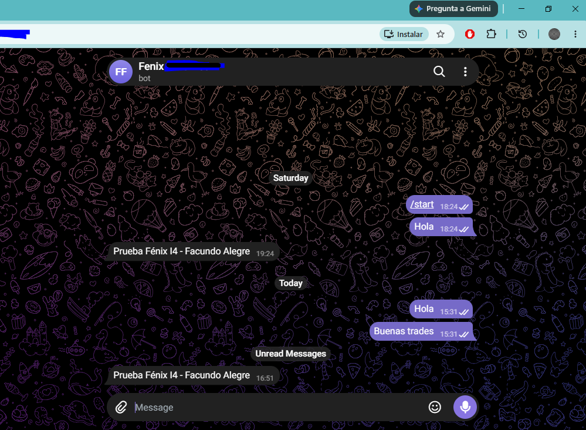

# F14 — Fallo temporal del aviso (429/timeout) y envío real

- **Fecha:** 2026-11-17
- **Responsable:** I4 — Alegre, Facundo Sebastián
- **Módulo:** `src/fenix/services/notifications.py`
- **Base:** `main` = `9ce3fd9` · PR #20

## Caso F14 — 429 y timeout sin repetir la reparación

### Comando

```bash
pytest tests/test_i4_observabilidad.py::test_f14_429_no_repite_reparacion \
  tests/test_i4_observabilidad.py::test_errores_de_red_son_reintentables -v
```

### Resultado obtenido

```text
collected 3 items

tests/test_i4_observabilidad.py::test_f14_429_no_repite_reparacion PASSED [ 33%]
tests/test_i4_observabilidad.py::test_errores_de_red_son_reintentables[error0] PASSED [ 66%]
tests/test_i4_observabilidad.py::test_errores_de_red_son_reintentables[error1] PASSED [100%]

============================== 3 passed in 0.10s ===============================
```

`test_f14_429_no_repite_reparacion` fuerza un 429 en el primer aviso: la
reparación ocurre una sola vez y el evento queda pendiente de reintento.
`test_errores_de_red_son_reintentables` cubre timeout y error de conexión como
`RetryableError`, sin ACK.

## Aviso real por Telegram

### Comando

```bash
set -a
source .env
set +a
NOTIFY_PROVIDER=telegram python -c "from fenix.services.notifications import notify; notify('Prueba Fénix I4 - Facundo Alegre')"
```

`notify` no imprime nada cuando el proveedor confirma; la confirmación es la
llegada del mensaje al chat.

### Captura



Captura del 2026-11-16, recortada para excluir chats de terceros. El token de la
URL y el identificador del chat están tapados.

## Observaciones

- El modo por defecto es `console`: sin `TELEGRAM_BOT_TOKEN` y
  `TELEGRAM_CHAT_ID` el comando imprime y no envía.
- El timeout HTTP es `(2, 5)` segundos y `Retry-After` se limita a 30 segundos.
- Un 429 o un 5xx se reintentan; un 4xx distinto de 429 es `PermanentError`.
